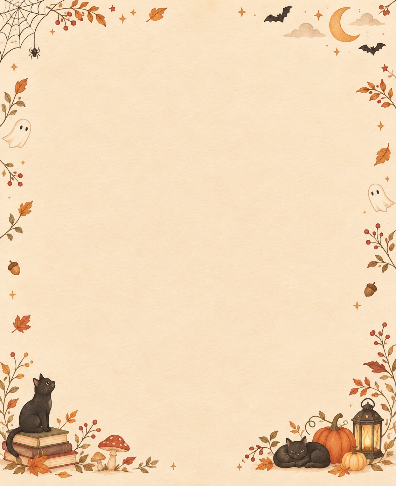

# Wallpapers for Aleph

Five seasonal wallpapers made for Aleph's Home. Each has a decorated border and an empty middle, so your widgets sit on a plain background.

| | | |
|---|---|---|
|  **Romantic Valentine** |  **Summer Beach** |  **Autumn Enchanted** |
|  **Christmas Wonderland** |  **Easter Garden** | |

## Using one

1. Download a picture: click it above, then the **Download raw file** button (↓). Or download **aleph-wallpapers.zip** from the [Releases page](https://github.com/lara-2-ko/aleph.koplugin/releases) for all five.
2. Copy it to your e-reader, for example next to your books.
3. In Aleph, hold a widget on Home (or **Settings → Home → Customize Home**), tap **+ Add wallpaper** and choose the picture.
4. **Fit → Fill** fills the screen. On a black-and-white screen, a **Wallpaper opacity** of about 30–50% keeps the widgets easy to read.

More in the wiki: [Wallpaper](https://github.com/lara-2-ko/aleph.koplugin/wiki/Wallpaper).
