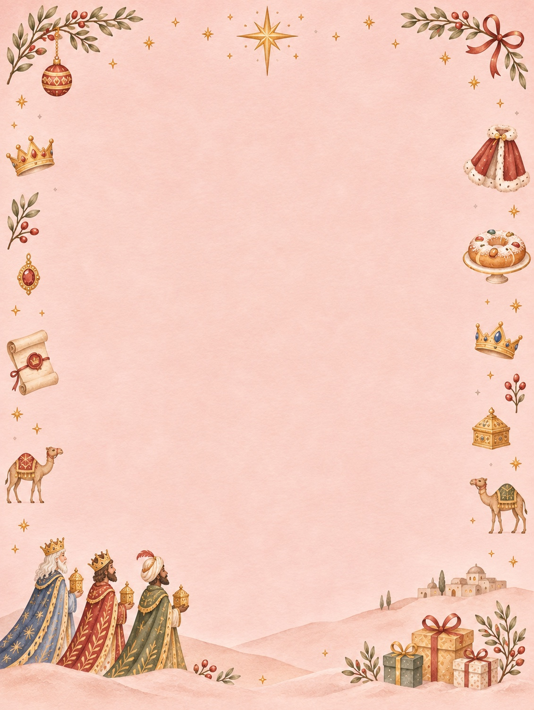

# Wallpapers for Aleph

Seven seasonal wallpapers made for Aleph's Home, at the Kindle Colorsoft's own size (1264 × 1680). Each has a decorated border and an empty middle, so your widgets sit on a plain background.

| | | |
|---|---|---|
|  **Three Kings** (6 January) |  **Romantic Valentine** |  **St Patrick's Day** |
|  **Easter Garden** |  **Summer Beach** |  **Autumn Enchanted** |
|  **Christmas Wonderland** | | |

## Using one

1. Download a picture: click it above, then the **Download raw file** button (↓). Or download **aleph-wallpapers.zip** from the [Releases page](https://github.com/lara-2-ko/aleph.koplugin/releases) for all seven.
2. Copy it to an `images` folder at the top of your e-reader (`/mnt/us/images` on a Kindle, `/mnt/onboard/images` on a Kobo): Aleph's picture picker opens there.
3. In Aleph, hold a widget on Home (or **Settings → Home → Customize Home**), tap **+ Add wallpaper** and choose the picture.
4. **Fit → Fill** fills the screen. On a black-and-white screen, a **Wallpaper opacity** of about 30–50% keeps the widgets easy to read. **Text over the wallpaper → Auto** keeps Home's own text readable.

More in the wiki: [Wallpaper](https://github.com/lara-2-ko/aleph.koplugin/wiki/Wallpaper).
